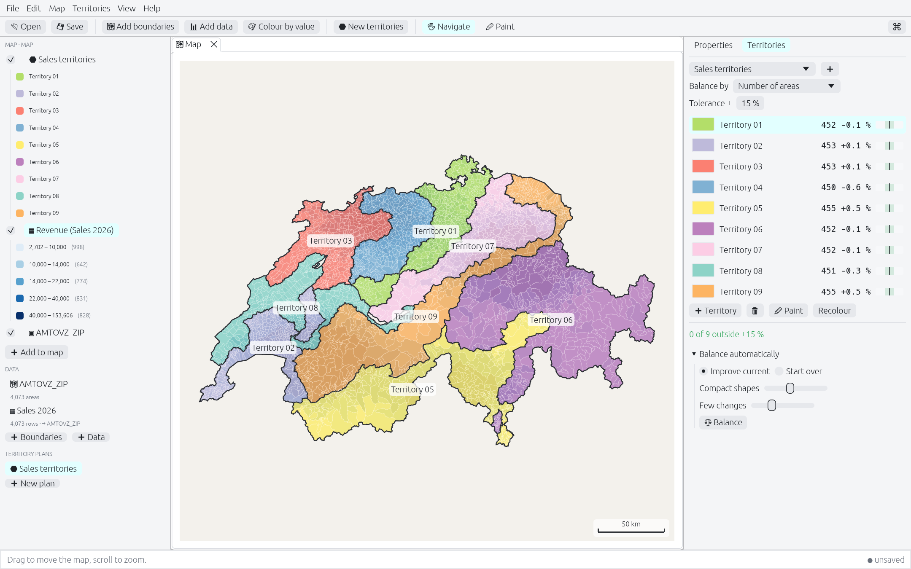

# Territoria

Put your data on the map and plan territories that are fair and compact.
Territoria is a native desktop tool for geomarketing and territory planning,
written in Rust (egui on wgpu), for Linux, Windows and macOS.



<sub>Swiss postcode boundaries © swisstopo; revenue figures are generated.</sub>

## What it does

**Boundaries from anywhere.** Postcodes, municipalities, sales regions or
any other areas: ESRI Shapefiles (also the zipped downloads statistical
offices publish), GeoPackages and GeoJSON. The coordinate system is read from the
`.prj` file (EPSG authority, ESRI names or the WKT parameters) or can be
given as an EPSG code; data is shown in Web Mercator. Text encodings of
attribute tables are detected. Nothing is tied to one country.

**Data on the map in a minute.** Add a CSV or Excel table: separators,
encodings, decimal commas, dates and column types are detected, and codes
such as postcodes keep their leading zeros. The column that matches the
areas is found automatically, also when leading zeros are missing or when
finer codes have to be rolled up onto coarser areas (`80331` → `80`). A
match report shows how many rows found their area and which didn't.

**Analyses.** Colour areas by a value (quantiles, equal intervals, natural
breaks, standard deviation, equal sums, or a smooth gradient) or by
category, with ColorBrewer ramps (colour-blind safe ones marked), a live
histogram of the classes and a legend in the Contents panel.

**Formulas.** Calculated columns in one formula language that reads the
same in every locale: `round([Revenue] / [Customers], 1)`,
`share([Revenue], [Region])`, `pad(left([Postcode], 2), 3)`. Mistakes are
underlined with a hint while typing (`There is no column [Revenu]. Did you
mean [Revenue]?`), suggestions complete column and function names, and a
preview shows the first rows.

**Territories.** Create a plan with empty territories and paint them on
the map, or start from an assignment table (areas may be listed as ranges
and wildcards: `8000-8099; 8105; 81*`). The Territories panel shows each
territory's figures against its target with the tolerance band, flags
territories that fall apart into pieces, and keeps up while you paint.
Locked territories and pinned areas stay put. **Balance** moves areas
between neighbouring territories until they are within tolerance, compact
and contiguous, with as few moves as possible, or builds territories from
scratch; the result is a proposal you apply or discard.

**Scenarios.** Duplicate a plan to try changes on the copy. The copy is
compared with the original: which areas move (marked on the map), how many
customers change territory, and each territory's figures before and after.
Export the changes to Excel, or adopt the scenario into the original.

Every change can be undone; projects are single `.territoria` files.

See [CONCEPT.md](CONCEPT.md) for the full plan and what is done.

## Building

Requirements: Rust (stable).

```sh
cargo build --release
./target/release/territoria
```

## Command line

Exports run without a window, for scripts and scheduled jobs:

```sh
territoria --export-map map.pdf project.territoria          # .png .svg .pdf .html
territoria --export-report report.pdf --plan "Sales" project.territoria
territoria --export-plan territories.xlsx project.territoria
```

## Development

```sh
cargo test --workspace
```

Screenshots of the real UI, rendered offscreen (needs a GPU or a software
Vulkan driver):

```sh
TERRITORIA_SCREENSHOT_DIR=/tmp/shots cargo test -p territoria-app screenshots -- --nocapture
```

They use a generated grid of hexagons, or real boundaries from
`TERRITORIA_TEST_BOUNDARIES` (any Shapefile, zip or GeoJSON).

### Workspace

| Crate | Purpose |
|---|---|
| `territoria-app` | the application: panels, map view, dialogs, commands |
| `territoria-geo` | coordinate systems, shared-border topology, simplification, spatial index |
| `territoria-data` | typed tables, type inference, key matching, aggregation |
| `territoria-expr` | the formula language: parser, type checking, functions, autocomplete |
| `territoria-io` | Shapefile, GeoJSON, CSV and Excel import |
| `territoria-model` | the project: layers, tables, links, plans, maps; file format; undo |
| `territoria-analysis` | colour ramps, classification, legends |
| `territoria-optimize` | territory balancing |
| `territoria-render` | levels of detail and drawing with egui |
| `territoria-config` | settings |
